<!-- Perfil do GitHub de Lucas de Paula Souza. Todas as afirmações vêm do CV e dos repositórios reais. -->

# Lucas de Paula Souza

**Computer Engineering student · AI & Software Systems**

-16a34a?style=flat-square)

---

## 👋 About me

I'm a Computer Engineering student in the **BRAFITEC double-degree program** between **UNIFEI** (Brazil) and **ENIB** (Brest, France). I'm finishing my engineering diploma at ENIB alongside a **Master 2 in Interactive, Intelligent and Autonomous Systems (SIIA)**.

## 🔭 What I'm doing now

- 🎓 Master 2 SIIA and engineering diploma at ENIB (graduating August 2027)
- 🔎 Looking for a **6-month end-of-studies internship** starting **February 22, 2027**, mostly around LLMs, RAG, agents and AI evaluation

## 🚀 Projects (solo & group)

<table>
<tr>
<td width="50%" valign="top">

**[DemocracIA](https://github.com/Lucas-P-Souza/DemocracIA)**

Answers questions about the official government plans of Brazil's 2026 presidential candidates. Each statement must point to a quote found in the source document, and it abstains when the plan doesn't cover the topic. Hybrid RAG without an orchestration framework, with two local LLMs compared.

`Python` `FastAPI` `React` `ChromaDB` `Ollama`

</td>
<td width="50%" valign="top">

**[MineChat](https://github.com/Lucas-P-Souza/MineChat)**

An AI assistant inside the Minecraft chat. A Java mod talks to a Flask backend with two agents: one filters prompt injections and off-topic requests, the other reasons with web search.

`Python` `Java` `Flask`

</td>
</tr>
<tr>
<td width="50%" valign="top">

**[DQN from scratch](https://github.com/Lucas-P-Souza/dqn-numpy-vs-pytorch)**

A Deep Q-Network solving CartPole-v1 in pure NumPy, with hand-derived backpropagation. PyTorch is only used as a reference to validate the gradients.

`Python` `NumPy` `Gymnasium`

</td>
<td width="50%" valign="top">

**[Digital Twin](https://github.com/Lucas-P-Souza/Digital-Twin)**

Vibration simulator for a guitar string: a 1D finite element solver in C++ connected to a PyQt5 interface through pybind11.

`C++` `Eigen` `pybind11` `PyQt5`

</td>
</tr>
<tr>
<td width="50%" valign="top">

**[DC motor control](https://github.com/Lucas-P-Souza/ips_mcc_stm32)**

Real-time firmware in C for a DC motor: 100 Hz PI loop with anti-windup, hardware PWM and current filtering, plus a [C++/Qt interface](https://github.com/Lucas-P-Souza/ips_mcc_stm32-IHM).

`C` `STM32` `C++` `Qt`

</td>
<td width="50%" valign="top">

**[PinguimCompiler](https://github.com/Lucas-P-Souza/PinguimCompiler)**

Compiler front-end and transpiler that translates a small domain-specific language to Python.

`Python` `PLY`

</td>
</tr>
<tr>
<td width="50%" valign="top">

**[BiblioTech](https://github.com/Lucas-P-Souza/BiblioTech)**

Library management system designed for a public school (not deployed). REST API with JWT authentication and role-based access.

`TypeScript` `Express` `Prisma`

</td>
<td width="50%" valign="top">

**[Mobile robot](https://github.com/Lucas-P-Souza/robot_mobile_ros2)**

ROS 2 mobile robot with OpenCV colour and centroid detection, and ROS 2 communication on a Raspberry Pi.

`ROS 2` `OpenCV` `Python`

</td>
</tr>
<tr>
<td width="50%" valign="top">

**[CAN bus sensor network](https://github.com/Lucas-P-Souza/Bus-Can-STM32)**

Sensor network over a CAN bus, with an anemometer node, Dynamixel motor control and CAN communication.

`C` `STM32` `CAN`

</td>
<td width="50%" valign="top">

**[MIPS processor](https://github.com/Lucas-P-Souza/MIPS_CPU)**

32-bit MIPS processor in Verilog, synthesized in Quartus Prime.

`Verilog` `Quartus Prime`

</td>
</tr>
<tr>
<td width="50%" valign="top">

**[SuperTuxKart controller](https://github.com/Lucas-P-Souza/STK_controller)**

Camera and Arduino based game controller for SuperTuxKart, using MediaPipe and OpenCV.

`Python` `MediaPipe` `OpenCV` `Arduino`

</td>
<td width="50%" valign="top">

**[HawkSec writeups](https://github.com/Lucas-P-Souza/Writeups)**

Capture-The-Flag writeups from my time in the UNIFEI cybersecurity group, HawkSec.

`CTF` `Cryptography` `Web security`

</td>
</tr>
</table>

## 🛠️ Tech I actually use

| Languages | Frameworks & libs | Hardware & embedded | Tools |
| :-: | :-: | :-: | :-: |
|  |  |  |  |

## 🐍 Contribution snake

<picture>
  <source media="(prefers-color-scheme: dark)" srcset="https://raw.githubusercontent.com/Lucas-P-Souza/Lucas-P-Souza/output/github-snake-dark.svg" />
  
</picture>

